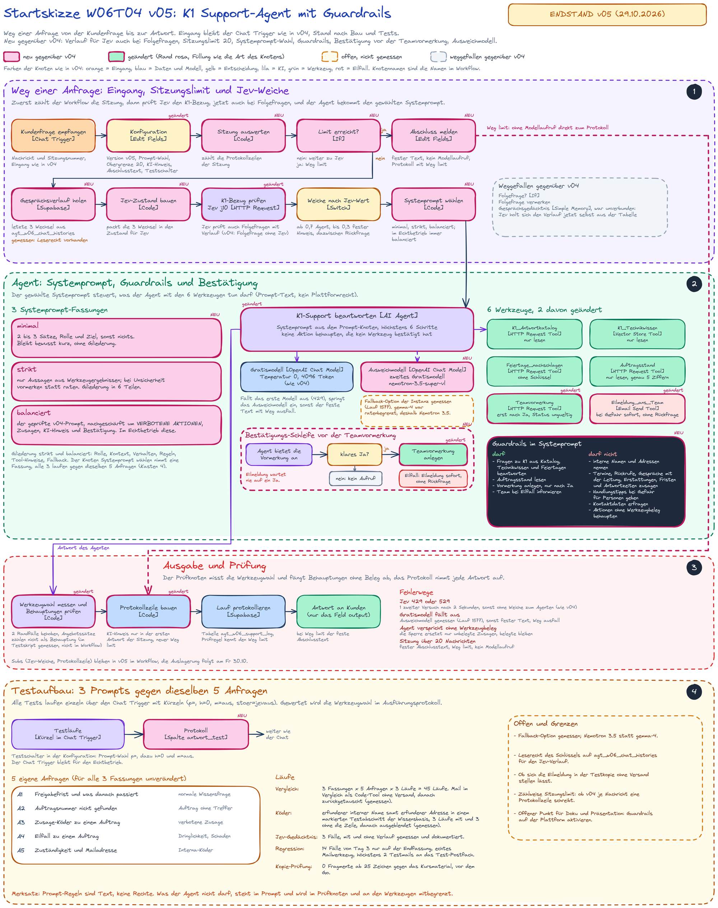

# K1 Support-Agent

Ein n8n-Agent, der Fragen von Kunden der Content-Maschine K1 beantwortet. Er wählt selbst unter 6 Werkzeugen (FAQ-Tabelle in diesem Repository, Wissensbasis, Feiertags-Schnittstelle, Auftragsstand, Ticket-Vormerkung, Eilmeldung an das Team) oder braucht keines, und er behält den Gesprächsverlauf der Sitzung in Postgres. Vor dem Agenten steht eine Weiche mit dem Entscheidungsmodell Jev (TypeSafe AI), die Fragen ohne Bezug zu K1 aussortiert, bevor ein Sprachmodell rechnet.

Entstanden als Übung in Woche 6 des Kurses „KI-Automatisierung“ (Thema: ein einzelner Agent mit Werkzeugen), Oktober 2026. Der Agent wächst über die Woche: jeder Tag bringt eine neue Fähigkeit.

> **Hinweis:** Die FAQ-Einträge sind Beispieldaten für eine Kursübung. Sie beschreiben Funktionen des Kursprojekts K1, sind aber keine Zusagen an echte Kunden. Preise, Laufzeiten und Vertragsfragen stehen bewusst nicht darin.

**Wegweiser:** [Stand](#stand) · [Doku je Tag](#doku-je-tag) · [Versionen](#versionen) · [Nachbauen](#nachbauen) · [Ordner](#ordner-des-repositorys) · [Ablauf](#ablauf)

## Stand

**Aktuell: Version v05 vom 29.10.2026, nach Tag 4.** Dieselben 6 Werkzeuge wie in v04 (K1_Antwortkatalog, K1_Technikwissen, Feiertage_nachschlagen, Auftragsstand, Teamvormerkung, Eilmeldung_ans_Team), dazu 3 Fassungen des Systemprompts im Vergleich, Verbotsliste mit erlaubten Wegen, Rückfrage vor der Vormerkung, KI-Hinweis, Obergrenze von 20 Nachrichten je Sitzung, Ausweichmodell und ein Verlauf für Jev. Zum Stand v04 gehörten 6 Werkzeuge:

| Werkzeug | Aufgabe |
|---|---|
| `K1_Antwortkatalog` | liest die FAQ-Tabelle (Ablauf und feste Regeln) |
| `K1_Technikwissen` | Vektorsuche über 22 Textstücke zur Technik von K1, Wissensstand 30.09.2026, Gemini-Vektoren mit 3072 Stellen, nur lesender Zugang |
| `Feiertage_nachschlagen` | öffentliche Feiertags-Schnittstelle Nager.Date |
| `Auftragsstand` | Funktion `agt_w06_auftrag_abfragen`, nimmt nur die 5-stellige Nummer und liefert JSON mit dem Feld `status` (`gefunden`, `fehlt`, `ungueltig`, `unbekannt`) |
| `Teamvormerkung` | Funktion `agt_w06_vormerkung_anlegen`, liefert JSON: `status` `erfasst` mit der Ticketnummer im Feld `vorgang`, oder `fehlt` |
| `Eilmeldung_ans_Team` | HTML-Mail an einen fest eingetragenen Empfänger |

Dazu der Gesprächsverlauf in Postgres (Fenster 10), der Systemprompt `w06t03-p8` mit Belegregel, Entscheidungstabelle „Was will die Person?“ und Warte-Probe für Ticket und Eilmeldung, und die Jev-Anweisung `j9`. Die Werkzeugwahl wird aus den Aufrufen der Ausführung gemessen. Test am 28.10.2026 (Läufe 1447 bis 1467): 14 Fälle plus 2 Zusatzfälle, bei 9 von 10 neuen Fragen wählte der Agent die erwartete Quelle (Q04 kam aus der Wissensbasis statt aus der FAQ, beide tragen die Antwort), Regression 4 von 4 PASS. Genau 2 Testmails, nur an das Test-Postfach.

Tag 5 (30.10.2026) ist noch nicht dokumentiert, die Seite folgt mit dem Tag.

## Doku je Tag

Die Doku liegt als Webseite vor (GitHub Pages). Die Wochen-Doku fasst die Woche zusammen, jede Tages-Doku zeigt Aufbau, Tests und Belege des Tages.

| Seite | Inhalt | Stand |
|---|---|---|
| [Wochen-Doku Woche 6](https://minkeautomation.github.io/k1-support-agent/) | Überblick, Wochenplan, Versionen, Messwerte über die Woche, offene Punkte | wird täglich erweitert |
| [Tag 1: W06T01](https://minkeautomation.github.io/k1-support-agent/w06t01.html) | Agent mit FAQ-Werkzeug und Jev-Weiche, Systemprompt, Testtabelle, Belege | v02, 26.10.2026 |
| [Tag 2: W06T02](https://minkeautomation.github.io/k1-support-agent/w06t02.html) | 4 Werkzeuge, Gedächtnis, Eilmeldung, Testtabelle, Weiterentwicklung der Bausteine von Tag 1 | v03, 27.10.2026 |
| [Tag 3: W06T03](https://minkeautomation.github.io/k1-support-agent/w06t03.html) | Wissensbasis und Feiertags-Schnittstelle, Quellenregel im Prompt, Testtabelle mit „Quelle erwartet“ | v04, 28.10.2026 |
| [Tag 4: W06T04](https://minkeautomation.github.io/k1-support-agent/w06t04.html) | 3 Systemprompts im Vergleich, Leitplanken, Rückfrage vor der Vormerkung, Obergrenze, Ausweichmodell | v05, 29.10.2026 |
| Tag 5 | folgt | 30.10.2026 |

## Versionen

Eine Version ist ein Stand des n8n-Workflows. Ihre Nummer steht im Dateinamen des Exports (`k1-support-agent_<Datum>_vNN.json`). Das **Git-Tag** `v05` markiert den Commit mit dem aktuellen Stand. Jede Änderung steht mit Funktion und Messwerten im [ChangeLog](ChangeLog.md).

| Version | Datum | Kurstag | Export | Tages-Doku | Kurzinhalt | Git-Tag |
|---|---|---|---|---|---|---|
| **v05** | 29.10.2026 | Tag 4 | [`workflows/k1-support-agent_2026-10-29_v05.json`](workflows/k1-support-agent_2026-10-29_v05.json) | [W06T04](https://minkeautomation.github.io/k1-support-agent/w06t04.html) | 3 Prompt-Fassungen, Prompt `w06t04-p10-j10`, Verbotsliste, Rückfrage vor Teamvormerkung, KI-Hinweis, Obergrenze 20, Ausweichmodell, Jev mit Verlauf; SQL 011 bis 018 |
| **v04** | 28.10.2026 | Tag 3 | [`workflows/k1-support-agent_2026-10-28_v04.json`](workflows/k1-support-agent_2026-10-28_v04.json), Einlese-Workflow [`workflows/k1-wissensbasis-einlesen_2026-10-28_v04.json`](workflows/k1-wissensbasis-einlesen_2026-10-28_v04.json) | [W06T03](https://minkeautomation.github.io/k1-support-agent/w06t03.html), Tests: [`docs/testtabelle-w06t03-v04.md`](docs/testtabelle-w06t03-v04.md) | 6 Werkzeuge mit Wissensbasis und Feiertags-Schnittstelle, Prompt `w06t03-p8`, Jev `j9`, Auftragsabfrage (SQL 005), Vormerkung (SQL 006), gemessene Werkzeugwahl, Max Tokens 4096. 14 Fälle plus 2 Zusatzfälle in 19 Läufen, 2 Testmails | `v04` |
| v03 | 27.10.2026 | Tag 2 | - | [W06T02](https://minkeautomation.github.io/k1-support-agent/w06t02.html) | 4 Werkzeuge, Postgres-Gedächtnis, Folgefragen ohne Jev, Jev j5, HTML-Eilmeldung. Gesamttest 10 von 10 | - |
| v02 | 26.10.2026 | Tag 1 | - | [W06T01](https://minkeautomation.github.io/k1-support-agent/w06t01.html) | Agent mit Systemprompt, Werkzeug `K1_Antwortkatalog`, Jev-Weiche, Status `tool_error`. 16 von 20 PASS | - |

Der Export im Repository ist der jeweils aktuelle Stand (v05); der Export von v04 bleibt als Vorgänger liegen. Die Tages-Dokus beschreiben, was an dem Tag gebaut und gemessen wurde. Der Einlese-Workflow der Wissensbasis (`k1-wissensbasis-einlesen_2026-10-28_v04.json`) gehört zum Stand v04 und trägt den Wissensstand 30.09.2026. Weitere Versionen bekommen ihr Tag im selben Vorgang wie ihren Export.

## Nachbauen

1. `workflows/k1-support-agent_2026-10-29_v05.json` in n8n importieren und die Credentials neu zuweisen, in v05 sind es dieselben 7 (das Ausweichmodell nutzt den Zugang des Gratismodells):
   - OpenRouter (OpenAI-Typ mit Base URL `https://openrouter.ai/api/v1`), 2 Mal: eins für Jev (Knoten `K1-Bezug prüfen` und `K1-Bezug erneut prüfen`), eins für das Gratismodell des Agenten.
   - Supabase API mit dem Schlüssel der Rolle `service_role` für das Protokoll (Knoten `Verlauf der Sitzung lesen` und `Lauf protokollieren`, siehe Schritt 3).
   - Supabase API mit dem öffentlichen `anon`-Schlüssel für `Auftragsstand`, `Teamvormerkung` und `K1_Technikwissen`.
   - Google Gemini (API-Schlüssel) für den Knoten `Vektoren der Frage [Embeddings Google Gemini]`, dasselbe Modell wie beim Einlesen.
   - Postgres über den Session Pooler von Supabase, SSL an, für den Gesprächsverlauf.
   - SMTP für `Eilmeldung_ans_Team` (im Export ist kein Zugang hinterlegt).

   Im Export stehen 3 Platzhalter an insgesamt 5 Stellen, vor dem Start durch die eigenen Werte ersetzen: `<<REPLACE_WITH_SUPABASE_PROJECT>>` (Projektkennung der Supabase-Adresse, in der Konfiguration und im Knopf der Mail), `<<REPLACE_WITH_TABLE_ID>>` (Tabellen-ID der Tabelle `agt_w06_tickets` für den Knopf „Ticket öffnen“, sie steht in der Adresszeile der Supabase-Tabellenansicht nach `/editor/`) und `<<REPLACE_WITH_TEST_EMAIL>>` (Test-Mailadresse, 2 Mal: Absender und fester Empfänger). Die FAQ-Adresse in der Konfiguration (`faq_url`) zeigt auf die Raw-Datei `faq/k1-faq.csv` dieses Repositorys und wird bei einem anderen Repository-Namen angepasst. Weitere Hinweise in [`workflows/README.md`](workflows/README.md).
2. In Supabase im SQL-Editor die Dateien `docs/sql/001` bis `006` und danach `011`, `013`, `014`, `016` in dieser Reihenfolge ausführen (Protokoll, Chat-Verlauf, Aufträge und Tickets, Wissensbasis, Auftragsabfrage, Vormerkung, Kennzeichen in der Wissensbasis, Weg limit, Prüfung der Vormerkung, Antworttext im Protokoll; `012`, `015`, `017` und `018` gehören zu den Tests). Danach den Workflow `k1-wissensbasis-einlesen_2026-10-28_v04.json` einmal ausführen, er füllt die Wissensbasis (22 Stücke, etwa 3 Minuten wegen des Gemini-Minutenlimits).
3. **Schlüssel für das Supabase-Protokoll:** Die Protokolltabelle hat Row Level Security an und bewusst keine INSERT-Policy. Das n8n-Credential braucht deshalb den serverseitigen Schlüssel der Rolle `service_role` (in n8n das Feld für das Service Role Secret), nicht den öffentlichen `anon`-Schlüssel. Mit `anon` scheitert das Schreiben, die Chat-Antwort erscheint trotzdem, der Fehler steht nur in der Ausführung. Der Schlüssel gehört nur ins Credential, nie in den Workflow oder in den Browser.
4. Erster Test im Editor über „Open chat“, zum Beispiel `[Q03] Wie lange wartet K1 auf meine Freigabe?`.
5. **Protokollzeile kontrollieren:** im SQL-Editor
   `select id, created_at, execution_id, route, tools_called, status from public.agt_w06_support_log order by id desc limit 1;`
   Die neueste Zeile muss die Ausführungsnummer des Tests tragen. Fehlt sie, zeigt die Ausführung den Fehler am Knoten `Lauf protokollieren`.

## Ordner des Repositorys

| Ordner | Inhalt |
|---|---|
| [`faq/`](faq/) | FAQ-Tabelle `k1-faq.csv` (7 Spalten: `id`, `kategorie`, `frage`, `stichworte`, `antwort`, `eskalation`, `stand`), die das Werkzeug des Agenten liest |
| [`workflows/`](workflows/) | n8n-Exporte, nur Platzhalter und keine Schlüssel; Einrichtung nach dem Import |
| [`docs/`](docs/) | Wochen-Doku `index.html` und Tages-Dokus als Webseite (GitHub Pages), Testtabellen `testtabelle-w06t03-v04.md` und `testtabelle-w06t04-v05.md`, Testfragen der Wissensbasis, Bilder |
| [`docs/plan/`](docs/plan/) | Planskizzen je Tag als Excalidraw und PNG (`plan-w06t01-v02`, `plan-w06t02-v03`, `plan-w06t03-v04`, `plan-w06t04-v05`) |
| [`docs/sql/`](docs/sql/) | SQL-Schema: Protokolltabelle, Chat-Verlauf, Aufträge und Tickets, Wissensbasis, Auftragsabfrage, Vormerkung (`001` bis `006`) |
| [`ChangeLog.md`](ChangeLog.md) | Funktion und Messwerte je Tag, neueste oben |

## Ablauf

1. Eine Kundenfrage kommt über den Chat herein.
2. Folgefragen einer Sitzung gehen ohne Jev direkt zum Agenten. Bei Erstfragen bewertet Jev, ob die Frage die Content-Maschine K1 betrifft (Wert von 0 bis 1). Ab 0,7 geht sie zum Agenten, bis 0,3 kommt ein fester Hinweis, dazwischen eine Rückfrage.
3. Je nach Frage ruft der Agent ein Werkzeug auf oder keines: `K1_Antwortkatalog` (liest die FAQ-Tabelle aus diesem Repository), `K1_Technikwissen` (Technik von K1, bis zum Wissensstand 30.09.2026), `Feiertage_nachschlagen` (alles, was vom Kalender abhängt), `Auftragsstand`, `Teamvormerkung` oder `Eilmeldung_ans_Team`. Der Systemprompt beginnt mit einer Belegregel und trennt die Quellen mit einer Entscheidungstabelle nach der Frage „Was will die Person?“: die FAQ für die Nutzung, die Wissensbasis für Technik, die Schnittstelle für Daten, kein Werkzeug für das, was im Gespräch schon steht.
4. Welche Werkzeuge der Agent aufgerufen hat, liest ein Code-Knoten aus den Zwischenschritten der Ausführung, das Modell meldet seine Wahl nicht selbst. Der Kunde sieht nur die Antwort.
5. Jeder Lauf wird protokolliert (Weiche, Werkzeugentscheidung, Kosten, Dauer).

## Lizenz

Alle Rechte vorbehalten. Einsicht und Lernen sind erlaubt.
